<p align="center">
  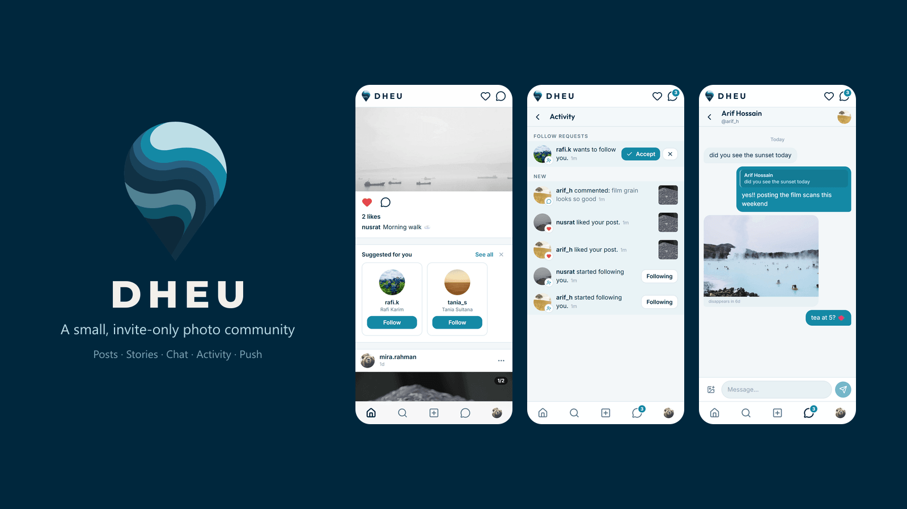
</p>

<h1 align="center">Dheu</h1>

<p align="center">
  An invite-only, Instagram-style photo community for a small circle of people, on the web and on Android.<br/>
  Public or private accounts, posts that expire after 3 months, 24-hour stories and notes, real-time chat with disappearing photos<br/>and push notifications, all running on free tiers.
</p>

<p align="center">
  <a href="https://dheu-beige.vercel.app"></a>
  <a href="https://github.com/brownfishsalman/Dheu-/releases/latest"></a>
  
  
  
  
  
  
  
</p>

*Dheu* means wave in Bengali. It's built for one small community that wanted the feel of early Instagram: photos from friends and nothing else, with no ads, no algorithm and no audience of strangers. You can only join with an invite code.

## Features

| | |
|---|---|
| **Public or private** | Each member picks one at sign-up and can switch later in Settings. Anyone in the community can see a public account's posts, stories, highlights and followers, and following it is instant. Following a private account sends a request that the owner accepts or declines from Activity, and only approved followers see what they post. Switching to public approves any pending requests. Row Level Security in Postgres enforces these rules. Blocking someone removes every tie between the two of you, in both directions, and hides you from each other. |
| **Posts** | 1 to 10 photos per post in a swipeable carousel, at any aspect ratio, with a caption, likes (double-tap works too) and comments. Every post expires 3 months after it's shared. |
| **Notes** | A 60-character note that sits above your avatar at the top of Messages for 24 hours. Mutual follows can see it, and a reply arrives as a DM that quotes the note. |
| **Stories** | 24-hour photo stories in a full-screen viewer with progress bars, tap, hold and swipe gestures, and keyboard controls on desktop. Viewers can react with an emoji or reply in chat, you can see who has seen each story, and Highlights keep chosen stories on your profile for good. |
| **Chat** | 1-to-1 and group chats delivered over WebSockets. A group holds up to 50 people; any member can add people or rename it, and the creator can remove people. Photos and voice messages (recorded in the browser, up to 2 minutes) disappear after 7 days. You can swipe to reply with a quote, unsend your own messages, and delete a chat from your inbox without affecting anyone else's. Unread badges, and a pinned read-only announcements thread from the admin in every inbox. |
| **Activity and push** | Follow requests, accepted requests, likes, comments, new followers and story reactions each raise an alert. Database triggers create them, a live badge counts them, and installed PWAs receive them as Web Push notifications (on Android, and on iOS 16.4+ from the Home Screen). |
| **Discovery** | People search, follower lists, and a "Suggested for you" strip, chosen by the admin, that turns up in the feed now and then. |
| **Photos** | Resized to 1080 px on the device before upload. HEIC files become JPEGs, EXIF orientation is applied, and GPS and other metadata are stripped. |
| **Accounts** | Email and password. Sign-up needs an invite code; members create single-use codes for friends and share them from Settings. The first account becomes the admin. Light, dark or system theme, and the website installs as a home-screen app (PWA). |
| **Admin** | Invite codes with use limits and expiry, suspending members, resetting passwords, deleting accounts, content moderation, curating suggestions, announcements, and an overview of storage use. |
| **Housekeeping** | A nightly job deletes expired posts, stories, chat photos and old notifications along with their files. |

## Screenshots

<p align="center">
  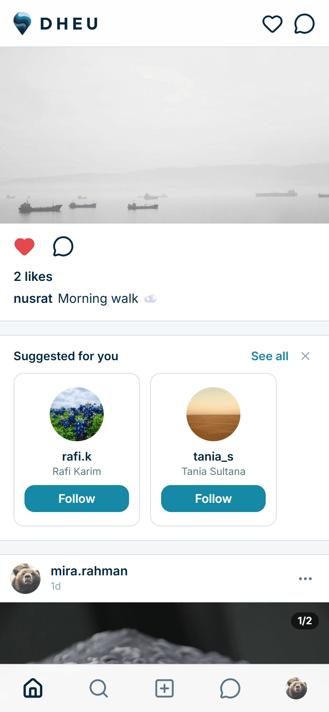
  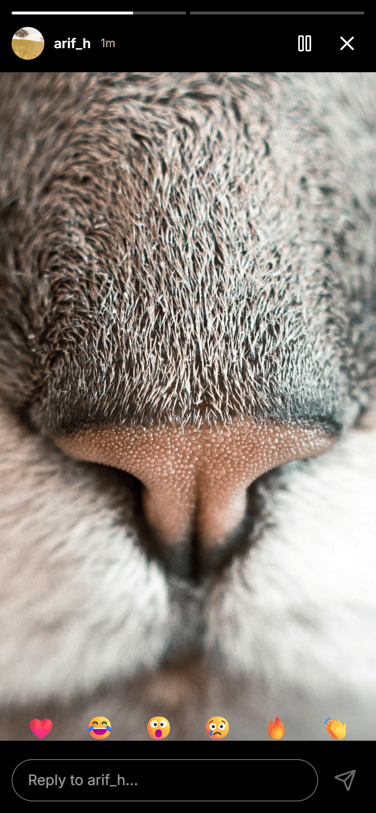
  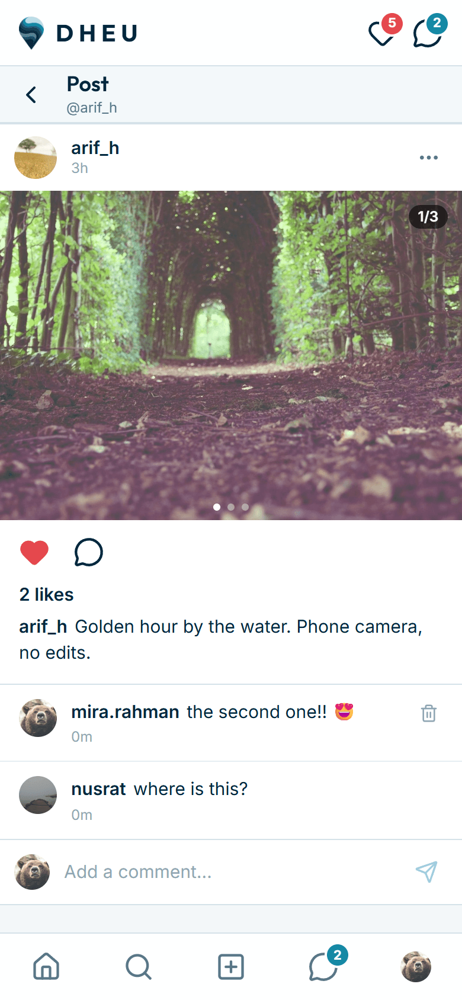
  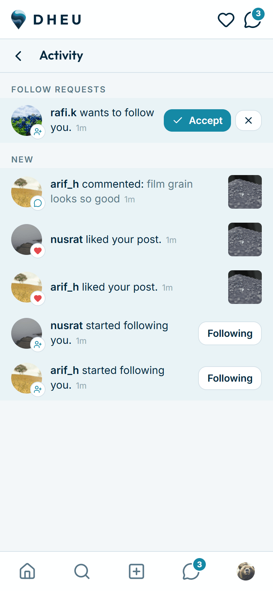
  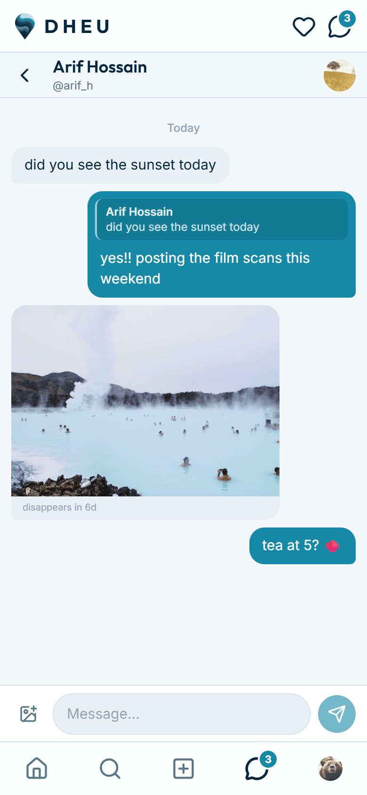
</p>
<p align="center">
  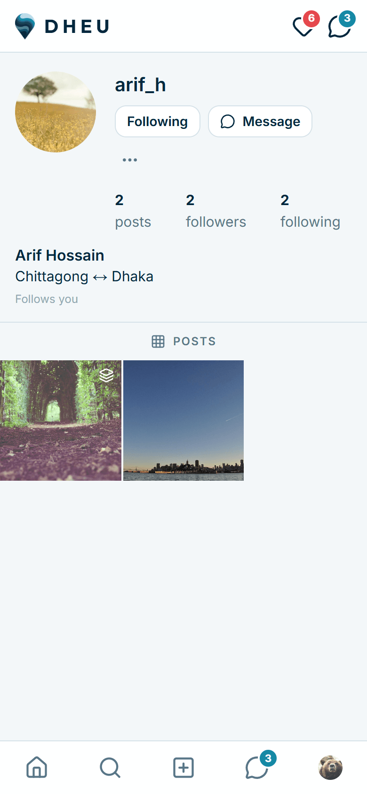
  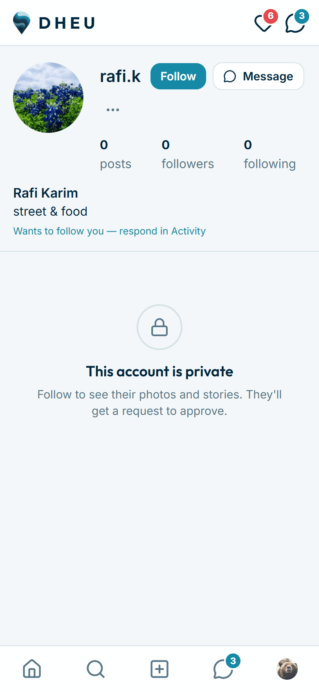
  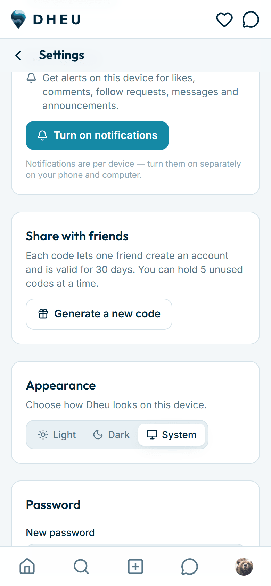
  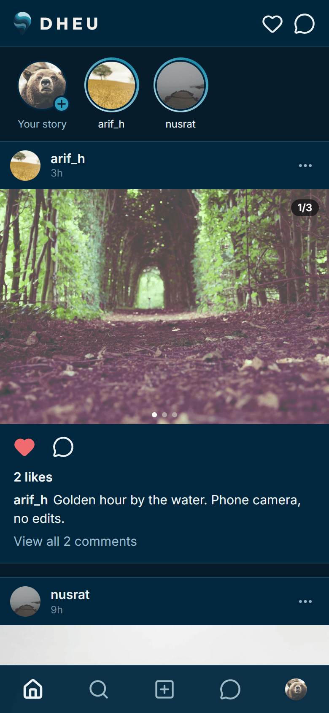
  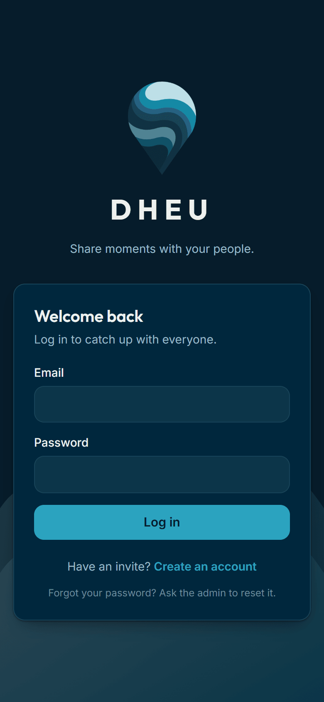
</p>
<p align="center">
  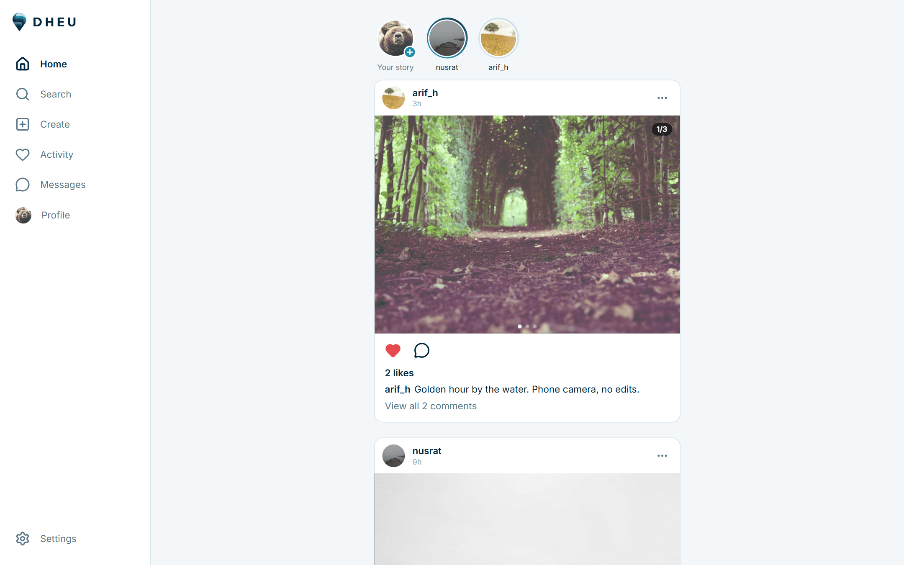
  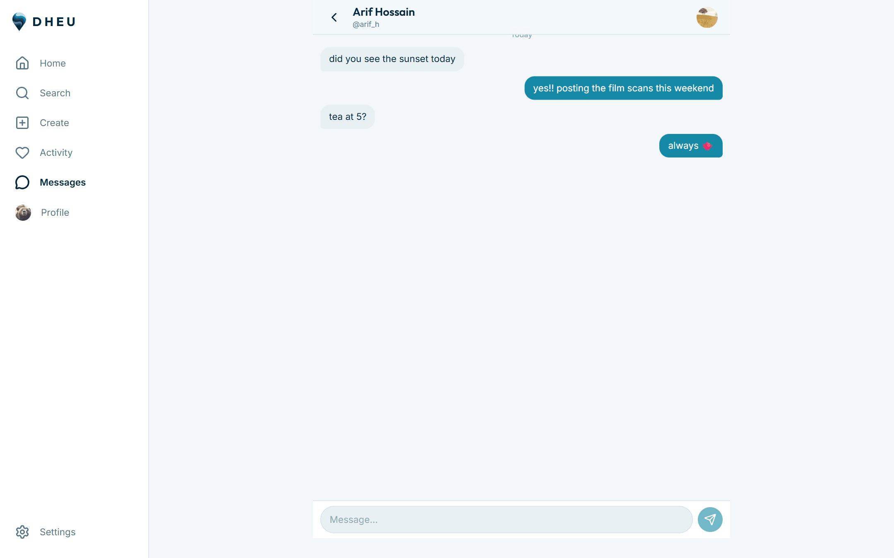
</p>

<sub>Demo accounts and stock photos; not real members.</sub>

## Android app

[`android/`](android) holds a native Android app written in Kotlin with Jetpack Compose. It uses the same Supabase project and the same Row Level Security rules as the website, so a member can move between the two and see the same feed, chats and notifications. It runs on Android 9 and newer.

Version 0.1.0 covers sign-up with an invite code and account type, the feed, posts (photos, likes, comments, sharing new ones), profiles with follow requests and public or private accounts, stories (viewing, posting, reactions and replies), Activity, and Messages with notes, 1-to-1 and group chats, photos, replies, unsend and delete chat. Settings has profile editing, account type, theme, password, blocked accounts and invite codes. Voice messages play in the app, but recording one, creating or managing a group, highlights, admin tools and push notifications are still website-only for now.

To try it, download the APK from the [latest release](https://github.com/brownfishsalman/Dheu-/releases/latest) on your phone and open it. Android will ask you to allow your browser to install apps; allow it for this one install. Build steps, release signing and a tour of the code are in [android/README.md](android/README.md).

## How it works

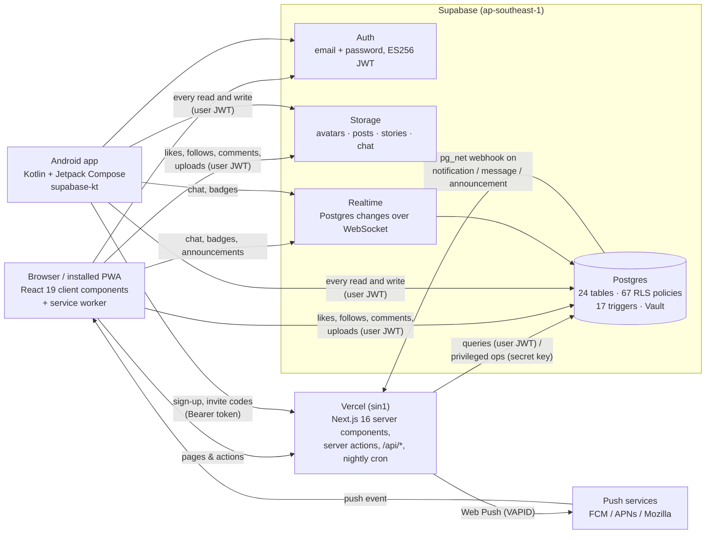

### One codebase, no separate backend

Next.js server components render pages on Vercel and query Supabase directly. The interactive parts (feed, story viewer, chat, uploads) are client components that talk to Supabase from the browser. The Android app also goes straight to Supabase through supabase-kt, and calls the website for only two jobs, explained in the next section.

### Security in the database

Every table has Row Level Security: 67 policies that Postgres checks against the caller's JWT. Members can change only their own rows, read only the chats they belong to, and update only the `read_at` column of their own notifications. The admin can delete anything. The browser and the APK carry only a publishable key, which grants nothing by itself. Privileged operations (invite-checked sign-up, bans, cleanup, sending push) run on the server with the secret key.

The secret key can't ship inside an APK, because anyone can unpack one. So the app sends sign-ups to `/api/auth/signup` and asks `/api/invites` for new invite codes, and the website does the privileged part. The invite endpoint verifies the member's Supabase access token before it creates a code.

### Privacy in one function

`can_view_content_of(author)` is true for your own content, for a public account, or for someone you follow, and never across a block. It is the single check behind the RLS policies for posts, images, comments, likes, stories and highlights. `follow_user()` follows a public account at once and sends a private one a `follow_requests` row, which only `accept_follow_request()` can turn into a `follows` row. Blocking fires a trigger that removes follows, requests and notifications in both directions.

### Notifications from triggers

Inserting a like, follow request, comment or story reaction fires a PL/pgSQL trigger that writes a notification row, and unliking or declining deletes it again. Realtime streams the insert to the recipient's open tab or app.

### Push: database, then site, then device

A second trigger on notifications, messages and announcements calls the site's `/api/push` through `pg_net`. The call is asynchronous, carries a shared secret kept in Supabase Vault, and can't block the original insert. The endpoint looks up the recipient's devices and sends a VAPID-signed Web Push; the service worker shows it and opens the right screen on tap. Read markers use the database clock, so a phone with a wrong clock can't leave things marked unread.

### Photos are processed on the device

No server touches a photo before it's stored. The website decodes the file in the browser (HEIC through a WebAssembly build of libheif) and the Android app uses the platform's `ImageDecoder`. Both fix the orientation and redraw the photo at up to 1080 × 1920, which also strips all metadata, and cut a 480 px square thumbnail for profile grids. The JPEGs go straight to Storage under `<userId>/<uuid>.jpg`, and Storage policies allow writes only into your own folder.

### Expiry is a timestamp

`posts.expires_at` defaults to `now() + 3 months` and notes to `now() + 24 hours`. A trigger stamps chat photos and voice messages with `now() + 7 days` on insert, so a client can't pick its own expiry. RLS hides expired rows straight away, and a Vercel cron job (`/api/cron/cleanup`) deletes the rows and their files every night, keeping stories that are in a highlight.

### Region

Vercel's functions are pinned to the database's region (`vercel.json`), which on its own cut page render time by roughly 4×. Badge counts are rendered on the server and kept current over one shared Realtime channel, and a `loading.tsx` skeleton appears as soon as you navigate.

## Stack

- Website: Next.js 16 (App Router, Turbopack, server actions, `proxy.ts` for session refresh), React 19 and strict TypeScript. A hand-written `Database` type mirrors the schema, so every query is type-checked.
- Styling: Tailwind CSS 4 with a small set of tokens, light and dark themes, Inter and Outfit.
- Android: Kotlin, Jetpack Compose with Material 3, Navigation Compose, supabase-kt over Ktor and OkHttp, Coil for images, kotlinx.serialization.
- Supabase: Postgres (with `pg_net` webhooks and Vault), Auth, Storage and Realtime. The schema, policies and triggers are in [`supabase/migrations`](supabase/migrations).
- Vercel for hosting and cron, with functions pinned to the database's region.
- web-push (VAPID) for notifications, zod for input validation, lucide-react icons, heic-to for HEIC decoding.

About 10,600 lines of TypeScript, 6,500 of Kotlin and 2,400 of SQL (24 tables, 67 RLS policies, 17 triggers, 45 functions). The website has ten runtime dependencies.

## Running it yourself

```bash
git clone https://github.com/brownfishsalman/Dheu-.git
cd Dheu-
npm install
cp .env.example .env.local   # fill in your Supabase URL + keys
npm run dev
```

Then create a free Supabase project, run the files in `supabase/migrations/` in order in its SQL editor, and turn off "Confirm email" under Authentication. The first account to sign up becomes the admin. The [owner's guide](docs/OWNER-GUIDE.md) has full step-by-step instructions, including deploying to Vercel and day-to-day administration. To build the Android app against your own project, follow [android/README.md](android/README.md).

## Project layout

```
src/app/(auth)/            login & sign-up (server actions)
src/app/(app)/             everything behind login: feed, profiles, posts, stories,
                           highlights, messages, activity, settings, admin
src/app/api/auth/signup/   sign-up for the Android app (the invite check needs the secret key)
src/app/api/invites/       invite codes for the Android app (Bearer token)
src/app/api/cron/cleanup/  nightly expiry job
src/app/api/push/          receives database webhooks, sends Web Push
src/lib/push.ts            VAPID sending · src/lib/push-client.ts subscribe/unsubscribe · public/sw.js
src/proxy.ts               session refresh + login gate (runs on every request)
src/components/            UI: post/ story/ chat/ activity/ profile/ admin/ nav/ ui/ brand/
src/lib/data/              server-only query functions
src/lib/supabase/          browser / server / admin clients, realtime auth helper
src/lib/images.ts          browser-side image pipeline
supabase/migrations/       schema, RLS policies, triggers, storage buckets
scripts/build-logo.mjs     regenerates icons from the original logo artwork
android/                   the native Android app (see android/README.md)
```

## Design notes

- It's sized for free tiers: about 50 members and 1 GB of images. Resizing to 1080 px and expiring posts after 3 months keeps storage within that.
- Image URLs are public. Files sit at unguessable paths in public buckets instead of behind signed URLs, a deliberate trade-off for simplicity in a trusted community.
- There's no email. Free-tier SMTP can't reach arbitrary addresses, so sign-up needs no confirmation and password resets go through the admin.
- The repo holds no secrets. The push webhook secret lives in Supabase Vault and Vercel environment variables, and the committed migration has placeholders. The Android build reads its Supabase URL and publishable key from an uncommitted `local.properties`.
- Side effects fail safely. The push webhook trigger catches its own errors, so a notification problem can never block a like or a message.

## License

[GPL-3.0](LICENSE) © Salman Saadiq. The logo and the name *Dheu* are not covered by the licence.
